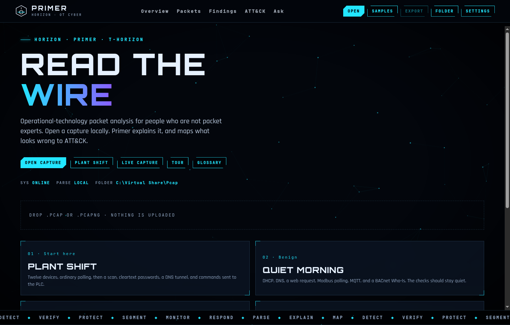

# Primer

**Network captures, explained for humans.**

Primer opens a packet capture and tells you, in plain English, what the traffic is doing, which machines look like plant equipment, and how that maps to MITRE ATT&CK for Enterprise and for ICS. It is an investigation tool for people who are not packet experts. It is not a Wireshark clone, and a capture on its own is not proof that a controller was exploited.



Built by **Andre Froneman**
GitHub: [AndreFroneman](https://github.com/AndreFroneman)
LinkedIn: https://www.linkedin.com/in/REPLACE-ME

Primer is free software under the GNU General Public License, version 2 or later. See `LICENSE`.

---

## Download

**[Download Primer 2.0.1 for Windows (`Primer_2.0.1_x64-setup.exe`)](https://github.com/AndreFroneman/ICS-PCAP-MITRE-Viewing-Tool/releases/download/v2.0.1/Primer_2.0.1_x64-setup.exe)**

Everything for version 2 is on the [v2.0.1 release page](https://github.com/AndreFroneman/ICS-PCAP-MITRE-Viewing-Tool/releases/tag/v2.0.1):

| File | What it is |
| --- | --- |
| `Primer_2.0.1_x64-setup.exe` | The Windows installer. |
| `Primer_2.0.1_docs.zip` | This README, the user guide, engine notes, test results, changelog, licence, and third-party notices, for a machine with no internet. |
| `SHA256SUMS.txt` | SHA-256 of every file on the release. |
| `wireshark-4.6.9.tar.xz` | The source that matches the bundled TShark. |

To check the download, run this in PowerShell in your Downloads folder and compare the result with `SHA256SUMS.txt`:

```powershell
Get-FileHash .\Primer_2.0.1_x64-setup.exe -Algorithm SHA256
```

The installer is **not code-signed**. Windows SmartScreen will say it does not recognise the app.

1. Choose **More info**.
2. Choose **Run anyway**.

What the installer is:

- One NSIS package, for the current user. Ordinary offline analysis does not ask for an administrator.
- Built for 64-bit Windows 10 and Windows 11.
- The WebView2 offline installer is inside the package, so an air-gapped Windows 10 PC does not have to download it. Windows 11 already has WebView2. On a clean Windows 10 machine, Microsoft's embedded installer may still ask for an administrator once, because that runtime is installed for the machine. Primer itself stays per-user.
- TShark 4.6.9 is included as its own program, for a deeper look at a frame. Primer's own decoder still opens the file if TShark is missing.
- Npcap is **not** included. The free Npcap licence does not allow bundling it.
- Suricata is **not** included. The usual Windows build will not even read a file unless Npcap's `wpcap.dll` is present. See `docs/ENGINES.md`.

Cases are stored under `Documents\Primer\Cases`. The folder Primer offers when you browse for a new file is still `C:\Virtual Share\Pcap`.

---

## Features

**Open a capture**

- Classic pcap and pcapng, both byte orders, microsecond and nanosecond timestamps, modified pcap, gzip, and several odd but real variants. The format is taken from the bytes, not the filename.
- Packet list, decode, hex, follow stream, and a Wireshark-like display filter.
- Parsing runs in a worker so the window stays responsive. Above a large size, Primer keeps the summary on screen and reads one frame from the case file when you open it.

**A case, not a throwaway view**

- The desktop app copies the file, records SHA-256, and marks that copy read-only. The original path is left alone.
- Notes, an activity log, and approve / reject / escalate on each finding. The engines do not make that decision.

**Industrial traffic**

- Modbus/TCP, DNP3, S7comm, EtherNet/IP/CIP, BACnet, IEC 60870-5-104, OPC UA Hello, and MQTT, beside ordinary IT protocols.
- Likely roles (PLC, engineering workstation, SCADA, historian, and others) with a confidence and an alternative. The screen says "likely".
- Writes and commands are shown with the alternative that they may be maintenance.

**Findings you can defend**

- Each card is **observed** (the bytes show it) or **possible** (the bytes are only consistent with that reading).
- Triage is three levels: anomaly, suspicious activity, and enough to open a formal investigation. Level 3 still is not a confirmed exploit.
- MITRE ATT&CK 20.0, Enterprise and ICS, offline. A list of techniques is not an attack chain.
- Optional Suricata hits, if you supply a binary that can run `suricata -r` with no Npcap. They sit behind a filter so they cannot bury a Modbus write.

**Ask the capture**

- Works fully offline. No model is required.
- Questions can name a role, a clock time, a sequence, or whether there is enough to open an investigation. Answers cite packet numbers the tools actually returned.
- Optional narrators stay behind a consent panel: an in-browser model, Ollama on this PC, or a cloud API with a key you provide. Cloud use shows the text that will be sent and can redact addresses. The raw capture is not uploaded.

**Report**

- One investigation report: executive summary, scope, evidence and hashes, assets, topology, suspicious activity, exploit assessment, MITRE, OT notes, packet evidence, limitations, and next actions.
- HTML, PDF, JSON, and CSV. If there is no level-3 finding, the exploit section is empty on purpose.

**Live capture (optional, separate)**

- Only if Npcap is already installed, and only from the Live capture button.
- Primer detects Npcap. If it is missing, the screen explains that and links to [npcap.com](https://npcap.com/#download).
- A recording is written to a pcapng and then opened as a normal case. Capturing may ask for an administrator. Opening a saved file never does.

---

## Quick start

1. Install Primer from the Releases page. If SmartScreen warns you, choose **More info**, then **Run anyway**.
2. Double-click a `.pcap` or `.pcapng`, or open Primer and choose a file. Try the Plant shift sample first.
3. Read the triage line. Level 1 can be ordinary plant traffic. Level 3 means "open an investigation", not "the PLC was hacked".
4. Open **Findings** and **OT**. Use **Approve**, **Reject**, or **Escalate** when you have decided.
5. Ask a question in **Ask**. Click a packet number to see the frame.
6. Export the investigation report from **Report**.

A longer walkthrough is in `docs/USER_GUIDE.md`.

---

## Documentation

| Document | Read it for |
| --- | --- |
| [User guide](docs/USER_GUIDE.md) | Installing, opening a capture, the triage levels, every screen, and the questions Ask answers offline. |
| [Engines](docs/ENGINES.md) | What TShark, Suricata, Zeek, Npcap, and WebView2 do (or do not do) in this build. |
| [Test results](docs/TEST_RESULTS.md) | What was tested, on which captures, and what was not. |
| [Changelog](CHANGELOG.md) | What changed in each version. |
| [Third-party notices](THIRD_PARTY_NOTICES.md) | Licences and the source offer for bundled programs. |

The same files are in `Primer_2.0.1_docs.zip` on the release.

---

## Build from source

You need Node.js 22, Rust stable, and the usual Tauri prerequisites for the platform you are building on. The Windows installer is built on a Windows runner; see `.github/workflows/windows.yml`.

```bash
npm install
npm test
npm run dev            # browser, no engines, no case database
npm run desktop:build  # Windows NSIS installer, on Windows
```

The browser build is the same screens without TShark, Suricata, or the case folder. That is deliberate.

The Windows workflow downloads Wireshark 4.6.9, installs it silently so Npcap is not installed, and copies `tshark.exe` into the app. It also uploads `wireshark-4.6.9.tar.xz`, which is the source that matches that binary. It refuses to bundle `suricata.exe`, `wpcap.dll`, or an Npcap installer.

---

## Privacy

The capture stays on this computer unless you turn on a cloud narrator and approve the exact text Primer shows you. Redaction of IP and MAC addresses is on by default.

---

## Licence

Primer is GPL-2.0-or-later. `LICENSE` is the licence. `THIRD_PARTY_NOTICES.md` says where to get the Wireshark and Suricata source, and which other licences ship with the app.

TShark is a separate, unmodified program. Primer does not link `libwireshark`. Wireshark is a trademark of the Wireshark Foundation. Primer is not endorsed by the Wireshark project, the Suricata project, or Emerging Threats.

---

## Disclaimer

Primer is an analysis aid. Verify every finding before you act on it, and only analyse traffic you are allowed to inspect. A packet capture cannot prove that a controller was successfully exploited.
